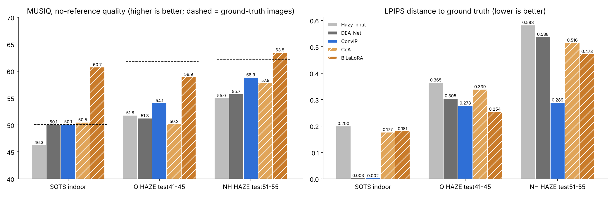
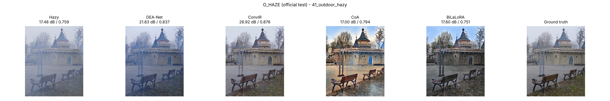
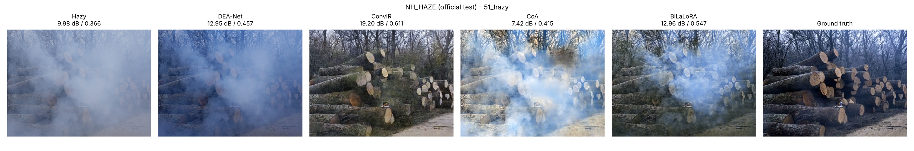

# Single-Image Dehazing Benchmark: 4 Recent Models (2024–2026) × 3 Datasets

Reproducible evaluation of four recent deep dehazing networks on **RESIDE-SOTS indoor**, **O-HAZE** and **NH-HAZE**, using the authors' official code and pretrained weights and one shared metric implementation:

| Model | Venue | Type |
|---|---|---|
| **DEA-Net** | IEEE TIP 2024 | Paired-supervised (synthetic RESIDE) |
| **ConvIR** | IEEE TPAMI 2024 | Paired-supervised (one checkpoint per benchmark) |
| **CoA** | CVPR 2025 | Real-world: synthetic pre-training + unpaired real-photo adaptation |
| **BiLaLoRA** | CVPR 2026 | Real-world: LoRA adaptation on unpaired real photos |

Metrics: **PSNR, SSIM, MAE** (fidelity to ground truth), **LPIPS** (perceptual distance) and **MUSIQ** (no-reference quality, as used by the real-world papers), plus parameters and inference time.

One command downloads the data and weights, runs all models and produces every table and figure below:

```bash
python run_all.py all
```


**Key findings**

- **ConvIR** is best on every fidelity metric (PSNR, SSIM, MAE, LPIPS) on all three test sets: 42.60 dB on SOTS, 24.64 dB on the O-HAZE test split, 20.66 dB on the NH-HAZE test split.
- **BiLaLoRA** has the highest no-reference quality (MUSIQ) on every set, above even the ground-truth images on SOTS and NH-HAZE, and the best LPIPS on O-HAZE, but low PSNR: it produces sharp, high-contrast images that do not match the reference colours.
- **CoA** is the smallest and fastest model (1.69 M parameters, 0.1 s per 1600 × 1200 image) but the weakest on real haze.
- **DEA-Net** is strong on synthetic haze (41.22 dB) but, without real-haze weights, removes little real haze.

---

## Results

Main results: SOTS-indoor (all 500 images), O-HAZE official test images 41–45, NH-HAZE official test images 51–55. ConvIR's O-HAZE and NH-HAZE checkpoints were trained on those datasets' training images, so only the test splits are a fair comparison.

| Model | SOTS PSNR ↑ | SOTS SSIM ↑ | SOTS LPIPS ↓ | SOTS MUSIQ ↑ | O-HAZE PSNR | O-HAZE SSIM | O-HAZE LPIPS | O-HAZE MUSIQ | NH-HAZE PSNR | NH-HAZE SSIM | NH-HAZE LPIPS | NH-HAZE MUSIQ |
|---|---|---|---|---|---|---|---|---|---|---|---|---|
| Hazy input | 11.97 | 0.695 | 0.200 | 46.3 | 14.97 | 0.638 | 0.365 | 51.8 | 11.34 | 0.418 | 0.583 | 55.0 |
| DEA-Net (2024) | 41.22 | 0.994 | 0.003 | 50.1 | 18.77 | 0.728 | 0.305 | 51.3 | 12.55 | 0.467 | 0.538 | 55.7 |
| ConvIR (2024) | **42.60** | **0.995** | **0.002** | 50.1 | **24.64** | **0.820** | 0.278 | 54.1 | **20.66** | **0.691** | **0.289** | 58.9 |
| CoA (2025) | 18.55 | 0.830 | 0.177 | 50.5 | 15.83 | 0.745 | 0.339 | 50.2 | 10.32 | 0.510 | 0.516 | 57.8 |
| BiLaLoRA (2026) | 19.61 | 0.806 | 0.181 | **60.7** | 18.30 | 0.745 | **0.254** | **58.9** | 11.87 | 0.553 | 0.473 | **63.5** |
| *Ground-truth images* | – | – | – | *50.1* | – | – | – | *61.8* | – | – | – | *62.2* |

Full tables (incl. MAE and all 45 / 55 real images): [`results/summary.md`](results/summary.md), [`results/table_PSNR.csv`](results/table_PSNR.csv), `table_SSIM.csv`, `table_MAE.csv`, `table_LPIPS.csv`, `table_MUSIQ.csv`. Per-image scores: [`results/per_image/`](results/per_image), [`results/per_image_perceptual/`](results/per_image_perceptual).



### Reproduction of published results

| Model | Benchmark | Paper | This repo |
|---|---|---|---|
| DEA-Net | SOTS-indoor | 41.31 dB / 0.9945 | 41.22 dB / 0.9938 |
| ConvIR-B | SOTS-indoor | 42.72 dB / 0.997 | 42.60 dB / 0.9948 |
| ConvIR-B | NH-HAZE test | 20.66 dB / 0.802 | 20.66 dB / 0.691 |
| ConvIR-B | O-HAZE test | 25.36 dB / 0.780 | 24.64 dB / 0.820 (images downscaled to 1600 px) |

CoA and BiLaLoRA report only no-reference metrics (FADE, BIQME, Entropy, MUSIQ) on RTTS / URHI / Fattal, so there is no published PSNR to compare. SSIM differences come from implementation details (ConvIR computes SSIM on downsampled images; we use full-resolution scikit-image SSIM for all models).

### Efficiency (RTX 2080 Ti, FP32, seconds per image)

| Model | Params (M) | SOTS 620×460 | O-HAZE ≤1600 px | NH-HAZE 1600×1200 |
|---|---|---|---|---|
| DEA-Net | 3.65 | 0.055 | 0.403 | 0.359 |
| ConvIR-B | 8.63 | 0.114 | 0.833 | 0.763 |
| CoA | 1.69 | **0.035** | **0.115** | **0.099** |
| BiLaLoRA | 3.76 | 0.061 | 0.447 | 0.402 |

### Qualitative examples (official test images for O-HAZE and NH-HAZE)

Hazy · DEA-Net · ConvIR · CoA · BiLaLoRA · ground truth (PSNR / SSIM above each panel)





---

## Why these models: survey of 2025–2026 dehazing models

We found 12 single-image dehazing models published in 2025–2026. Only three had both official code and downloadable pretrained weights; two of them could be run.

| Model | Venue | Code | Weights | Used |
|---|---|---|---|---|
| CoA | CVPR 2025 | yes | Google Drive | **yes** |
| BiLaLoRA | CVPR 2026 | yes | Google Drive | **yes** |
| UDPNet | arXiv 2026 | yes | Baidu only (login needed) | shortlisted, not run |
| IPC-Dehaze | CVPR 2025 | yes | partial | no |
| Learning Hazing to Dehazing (DiffDehaze) | CVPR 2025 | yes | Baidu + Stable Diffusion | no |
| DehazeXL | CVPR 2025 | yes | no link | no |
| Dehaze-RetinexGAN | AAAI 2025 | no | – | no |
| Equivariant Learning (unsupervised) | arXiv 2026 | no | – | no |
| API | arXiv 2026 | no | – | no |
| DDR-Net | arXiv 2026 | no | – | no |
| In-Context Tabular Inference | arXiv 2026 | no | – | no |
| Hihaze | arXiv 2026 | no | – | no |

DEA-Net and ConvIR (2024) are the strongest paired-supervised models with released weights and serve as the supervised reference.

---

## Quick start

**Requirements:** Python 3.10+ (tested on 3.13), NVIDIA GPU recommended (tested on RTX 2080 Ti, 11 GB), about 3 GB of disk for data, weights and metric models.

### Windows (one click)

Double-click **`START_HERE.bat`**: it installs PyTorch (CUDA build if an NVIDIA GPU is found) and the requirements, then runs the whole pipeline.

### Any OS

```bash
git clone <this-repo-url>
cd dehazing-benchmark
pip install torch torchvision --index-url https://download.pytorch.org/whl/cu126   # or: pip install torch torchvision (CPU)
pip install -r requirements.txt
python run_all.py all
```

### Step by step

```bash
python run_all.py download     # datasets + official pretrained weights (resumable)
python run_all.py organize     # pair images into datasets/<name>/{hazy,gt}
python run_all.py infer        # run all models -> predictions/<dataset>/<model>/
python run_all.py evaluate     # PSNR / SSIM / MAE + figures
python run_all.py perceptual   # MUSIQ + LPIPS (downloads the metric models once)
python run_all.py summary      # rebuild tables/figures from results/per_image*/
python run_all.py status       # what is downloaded / predicted

# options
python run_all.py all --limit 5                  # quick test, 5 images per dataset
python run_all.py infer --models ConvIR --datasets O_HAZE
python run_all.py infer --tile 512               # low-memory tiled inference
```

Or open **`Assignment2_Dehazing.ipynb`** and run the cells top to bottom. Every run's console output is appended to `results/run_log.txt`; finished downloads and predictions are skipped on re-runs (`--overwrite` to recompute).

---

## Repository structure

```
dehazing-benchmark/
├── run_all.py                      # CLI: download / organize / infer / evaluate / perceptual / summary / status
├── START_HERE.bat                  # Windows one-click setup + full run
├── Assignment2_Dehazing.ipynb      # same pipeline as a notebook
├── requirements.txt
├── configs/
│   ├── experiment.json             # full experimental configuration
│   └── preprocessing/*.json        # per-dataset preprocessing record
├── dehaze_lib/
│   ├── config.py                   # models, dataset/weight sources, checkpoint per dataset, test splits
│   ├── download.py                 # dataset + weight download (resume, rar extraction)
│   ├── data.py                     # dataset organisation and hazy↔GT pairing
│   ├── models.py                   # model loading, official pre/post-processing, inference
│   ├── evaluate.py                 # PSNR / SSIM / MAE, tables, figures
│   └── perceptual.py               # MUSIQ + LPIPS
├── third_party/                    # authors' model code (SOURCE.txt in each folder)
│   ├── dea/  convir/  coa/  bilalora/
└── results/                        # results of our run
# created when you run it (git-ignored): downloads/  datasets/  weights/  predictions/
```

## Models, weights and processing

| Model | Code | Checkpoint (SOTS / O-HAZE / NH-HAZE) | Pre/post-processing (from the authors' test scripts) |
|---|---|---|---|
| DEA-Net | [cecret3350/DEA-Net](https://github.com/cecret3350/DEA-Net) | ITS / OTS / OTS | [0,1], reflect-pad to ×4 |
| ConvIR-B | [c-yn/ConvIR](https://github.com/c-yn/ConvIR) | its-base / ohaze-base / nhhaze-base | [0,1], reflect-pad to ×32, full-scale output |
| CoA | [YanZhang-zy/CoA](https://github.com/YanZhang-zy/CoA) | EMA_r (all sets) | CLIP normalisation, bicubic resize to ×16 and back |
| BiLaLoRA | [YanZhang-zy/BiLaLoRA](https://github.com/YanZhang-zy/BiLaLoRA) | Base + LoRA (all sets) | same as CoA; LoRA r = 8, α = 16 on 3 layers |

Changes to the authors' code are listed in `third_party/*/SOURCE.txt` (import paths only; BiLaLoRA: an unused IPython debug import removed).

## Data

| Dataset | Source | Notes |
|---|---|---|
| RESIDE-SOTS indoor | [HF mirror](https://huggingface.co/datasets/desonglll/reside-SOTS) of [RESIDE](https://sites.google.com/view/reside-dehaze-datasets/reside-standard) | 500 hazy images of 50 scenes |
| O-HAZE | [HF mirror](https://huggingface.co/datasets/dronefreak/NTIRE-Haze) of [O-HAZE](https://data.vision.ee.ethz.ch/cvl/ntire18/o-haze/) | 45 pairs, downscaled to 1600 px long side; test = 41–45 |
| NH-HAZE | [Official](https://data.vision.ee.ethz.ch/cvl/ntire20/nh-haze/) | 55 pairs; test = 51–55 |

## Evaluation protocol

Same test images, same pre-processing and the same metric code for every model. PSNR and SSIM from scikit-image (RGB, data range 1, Gaussian SSIM σ = 1.5); MAE in [0, 1]; LPIPS with AlexNet features (`lpips` package); MUSIQ with the KonIQ-10k checkpoint (`pyiqa`). The unprocessed hazy input and the ground-truth images (MUSIQ) are scored as references.

## Citation

```bibtex
@article{chen2024dea,  title={DEA-Net: Single Image Dehazing Based on Detail-Enhanced Convolution and Content-Guided Attention}, author={Chen, Zixuan and He, Zewei and Lu, Zhe-Ming}, journal={IEEE TIP}, volume={33}, pages={1002--1015}, year={2024}}
@article{cui2024convir, title={Revitalizing Convolutional Network for Image Restoration}, author={Cui, Yuning and Ren, Wenqi and Cao, Xiaochun and Knoll, Alois}, journal={IEEE TPAMI}, year={2024}}
@inproceedings{ma2025coa, title={CoA: Towards Real Image Dehazing via Compression-and-Adaptation}, author={Ma, Long and Feng, Yuxin and Zhang, Yan and Liu, Jinyuan and Wang, Weimin and Chen, Guangyong and Xu, Chengpei and Su, Zhuo}, booktitle={CVPR}, year={2025}}
@inproceedings{zhang2026bilalora, title={Bilevel Layer-Positioning LoRA for Real Image Dehazing}, author={Zhang, Yan and Ma, Long and Feng, Yuxin and Huang, Zhe and Zhou, Fan and Su, Zhuo}, booktitle={CVPR}, year={2026}}
@article{li2019reside, title={Benchmarking Single-Image Dehazing and Beyond}, author={Li, Boyi and Ren, Wenqi and Fu, Dengpan and Tao, Dacheng and Feng, Dan and Zeng, Wenjun and Wang, Zhangyang}, journal={IEEE TIP}, volume={28}, number={1}, pages={492--505}, year={2019}}
@inproceedings{ancuti2018ohaze, title={O-HAZE: A Dehazing Benchmark with Real Hazy and Haze-Free Outdoor Images}, author={Ancuti, Codruta O. and Ancuti, Cosmin and Timofte, Radu and De Vleeschouwer, Christophe}, booktitle={CVPR Workshops}, year={2018}}
@inproceedings{ancuti2020nhhaze, title={NH-HAZE: An Image Dehazing Benchmark with Non-Homogeneous Hazy and Haze-Free Images}, author={Ancuti, Codruta O. and Ancuti, Cosmin and Timofte, Radu}, booktitle={CVPR Workshops}, year={2020}}
@inproceedings{ke2021musiq, title={MUSIQ: Multi-scale Image Quality Transformer}, author={Ke, Junjie and Wang, Qifei and Wang, Yilin and Milanfar, Peyman and Yang, Feng}, booktitle={ICCV}, year={2021}}
@inproceedings{zhang2018lpips, title={The Unreasonable Effectiveness of Deep Features as a Perceptual Metric}, author={Zhang, Richard and Isola, Phillip and Efros, Alexei A. and Shechtman, Eli and Wang, Oliver}, booktitle={CVPR}, year={2018}}
```

## Acknowledgements and license

Model code and weights belong to the authors of DEA-Net, ConvIR, CoA and BiLaLoRA; datasets to the RESIDE, O-HAZE and NH-HAZE authors; MUSIQ via [pyiqa](https://github.com/chaofengc/IQA-PyTorch) and LPIPS via [lpips](https://github.com/richzhang/PerceptualSimilarity). AI assistance (Claude, Anthropic) was used to write the pipeline, adapt the code and draft documentation; all code was run and verified. Code in `dehaze_lib/`, `run_all.py` and the notebook: MIT (see [LICENSE](LICENSE)); `third_party/` keeps its authors' terms.
