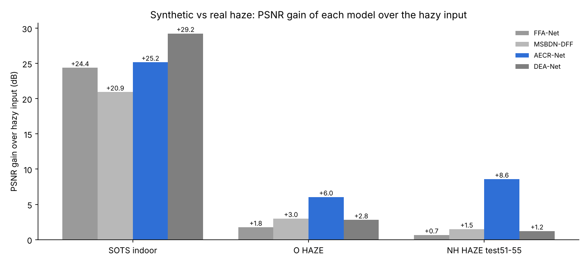
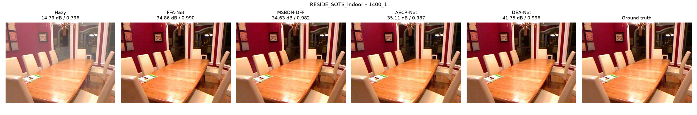
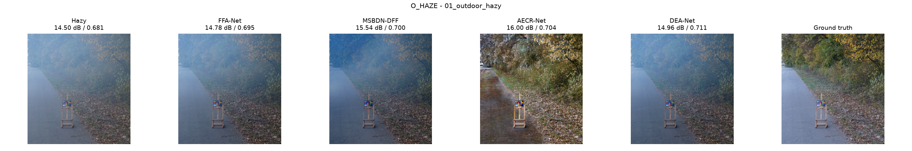
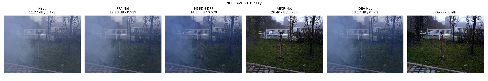

# Single-Image Dehazing Benchmark: 4 Models × 3 Datasets

Reproducible evaluation of four recent deep dehazing networks — **FFA-Net**, **MSBDN-DFF**, **AECR-Net** and **DEA-Net** — on **RESIDE-SOTS indoor**, **O-HAZE** and **NH-HAZE**, using the authors' official code and pretrained weights and one shared metric implementation.

One command downloads the data and weights, runs all four models, and produces every table and figure below:

```bash
python run_all.py all
```



**Key finding:** DEA-Net is best on synthetic haze (41.22 dB on SOTS), but AECR-Net — the only model with weights trained on real haze — is best on both real datasets. Models trained only on synthetic RESIDE data improve real hazy images by just 0.7–3.0 dB.

---

## Results

Mean over all test images. PSNR in dB (↑), SSIM (↑), MAE (↓). Best per column in **bold**.

| Model | SOTS-indoor PSNR | SOTS-indoor SSIM | O-HAZE PSNR | O-HAZE SSIM | NH-HAZE test PSNR | NH-HAZE test SSIM |
|---|---|---|---|---|---|---|
| Hazy input (no dehazing) | 11.97 | 0.6947 | 13.74 | 0.6096 | 11.34 | 0.4182 |
| FFA-Net | 36.36 | 0.9879 | 15.50 | 0.6499 | 12.00 | 0.4431 |
| MSBDN-DFF | 32.91 | 0.9808 | 16.73 | 0.6733 | 12.83 | 0.4648 |
| AECR-Net | 37.14 | 0.9893 | **19.78** | **0.7432** | **19.92** | **0.6717** |
| DEA-Net | **41.22** | **0.9938** | 16.53 | 0.6843 | 12.55 | 0.4669 |

N = 500 (SOTS indoor), 45 (O-HAZE), 5 (NH-HAZE official test images 51–55). Full tables including MAE and all 55 NH-HAZE images: [`results/summary.md`](results/summary.md), [`results/table_PSNR.csv`](results/table_PSNR.csv), [`results/table_SSIM.csv`](results/table_SSIM.csv), [`results/table_MAE.csv`](results/table_MAE.csv). Per-image scores: [`results/per_image/`](results/per_image).

> **NH-HAZE split:** AECR-Net's NH-HAZE checkpoint was trained on images 01–45, so its score over all 55 images (21.88 dB) is inflated. The fair comparison uses the official test images 51–55 (column above). See [`results/NOTE_NH_HAZE_official_test_split.md`](results/NOTE_NH_HAZE_official_test_split.md).

### Reproduction of published SOTS-indoor results

| Model | Paper PSNR / SSIM | This repo | Δ PSNR |
|---|---|---|---|
| FFA-Net | 36.39 / 0.9886 | 36.36 / 0.9879 | −0.03 |
| MSBDN-DFF | 33.79 / 0.9840 | 32.91 / 0.9808 | −0.88 |
| AECR-Net | 37.17 / 0.9901 | 37.14 / 0.9893 | −0.03 |
| DEA-Net | 41.31 / 0.9945 | 41.22 / 0.9938 | −0.09 |
| AECR-Net (NH-HAZE test) | 19.88 / 0.717 | 19.92 / 0.672 | +0.04 |

### Efficiency (RTX 2080 Ti, FP32, seconds per image)

| Model | Params (M) | SOTS 620×460 | O-HAZE ≤1600 px | NH-HAZE 1600×1200 |
|---|---|---|---|---|
| FFA-Net | 4.46 | ≈0.52* | 3.29 | 2.98 |
| MSBDN-DFF | 31.35 | 0.059 | 0.380 | 0.343 |
| AECR-Net | 2.61 | 0.051 | 0.388 | 0.348 |
| DEA-Net | 3.65 | 0.055 | 0.403 | 0.359 |

\*From the progress rate (incl. file I/O); the timing log of that run was lost on a restart. Raw timings: [`results/inference_log.csv`](results/inference_log.csv).

### Qualitative examples

Hazy · FFA-Net · MSBDN-DFF · AECR-Net · DEA-Net · ground truth (PSNR / SSIM above each panel)





---

## Quick start

**Requirements:** Python 3.10+ (tested on 3.13), an NVIDIA GPU recommended (tested on RTX 2080 Ti, 11 GB). About 2 GB of disk for data and weights.

### Windows (one click)

Double-click **`START_HERE.bat`**. It installs PyTorch (CUDA build if an NVIDIA GPU is found), installs the requirements, and runs the whole pipeline.

### Any OS (command line)

```bash
git clone <this-repo-url>
cd dehazing-benchmark

# 1. PyTorch: pick the build for your machine (https://pytorch.org/get-started/locally/)
pip install torch torchvision --index-url https://download.pytorch.org/whl/cu126   # NVIDIA GPU
# pip install torch torchvision                                                    # CPU only

# 2. Other dependencies
pip install -r requirements.txt

# 3. Run everything (download → organize → inference → evaluation)
python run_all.py all
```

### Step by step

```bash
python run_all.py download            # datasets + official pretrained weights (resumable)
python run_all.py organize            # pair images into datasets/<name>/{hazy,gt}
python run_all.py infer               # run all 4 models → predictions/<dataset>/<model>/
python run_all.py evaluate            # PSNR/SSIM/MAE tables + figures → results/
python run_all.py summary             # rebuild tables/figures from results/per_image/*.csv
python run_all.py status              # what is downloaded / predicted so far

# options
python run_all.py all --limit 5                       # quick test: 5 images per dataset
python run_all.py infer --models DEA-Net --datasets O_HAZE
python run_all.py infer --tile 512                    # low-memory tiled inference
python run_all.py evaluate --lpips                    # also LPIPS (pip install lpips)
```

Or open **`Assignment2_Dehazing_4models.ipynb`** and run the cells top to bottom.

Every run's console output is appended to `results/run_log.txt`. Re-running is safe: finished downloads and predictions are skipped (`--overwrite` to recompute).

---

## Repository structure

```
dehazing-benchmark/
├── run_all.py                         # CLI: download / organize / infer / evaluate / summary / status
├── START_HERE.bat                     # Windows one-click setup + full run
├── Assignment2_Dehazing_4models.ipynb # same pipeline as a notebook
├── requirements.txt
├── configs/
│   ├── experiment.json                # full experimental configuration (exported from dehaze_lib/config.py)
│   └── preprocessing/*.json           # per-dataset preprocessing record from our run
├── dehaze_lib/
│   ├── config.py                      # paths, dataset/weight sources, checkpoint per dataset, splits
│   ├── download.py                    # dataset + weight download (resume, checksum, rar extraction)
│   ├── data.py                        # dataset organisation and hazy↔GT pairing
│   ├── models.py                      # model loading, official pre/post-processing, inference
│   └── evaluate.py                    # PSNR/SSIM/MAE, tables, figures
├── third_party/                       # authors' model code (see SOURCE.txt in each folder)
│   ├── ffa/  msbdn/  aecr/  dea/
└── results/                           # results of our run (tables, per-image CSVs, figures, timing log)

# created when you run it (git-ignored):
downloads/  datasets/  weights/  predictions/
```

---

## Models

| Model | Paper | Official code | Weights used |
|---|---|---|---|
| FFA-Net | [Qin et al., AAAI 2020](https://arxiv.org/abs/1911.07559) | [zhilin007/FFA-Net](https://github.com/zhilin007/FFA-Net) | ITS (SOTS), OTS (O-HAZE, NH-HAZE) |
| MSBDN-DFF | [Dong et al., CVPR 2020](https://arxiv.org/abs/2004.13388) | [BookerDeWitt/MSBDN-DFF](https://github.com/BookerDeWitt/MSBDN-DFF) | RESIDE (all) |
| AECR-Net | [Wu et al., CVPR 2021](https://arxiv.org/abs/2104.09367) | [GlassyWu/AECR-Net](https://github.com/GlassyWu/AECR-Net) | ITS (SOTS), NH-HAZE (O-HAZE, NH-HAZE) |
| DEA-Net | [Chen et al., IEEE TIP 2024](https://arxiv.org/abs/2301.04805) | [cecret3350/DEA-Net](https://github.com/cecret3350/DEA-Net) | ITS (SOTS), OTS (O-HAZE, NH-HAZE) |

No author released O-HAZE weights and only AECR-Net released NH-HAZE weights, so results on the real-haze sets are mostly **cross-dataset generalisation**.

**Changes to the authors' code** (details in `third_party/*/SOURCE.txt`):

- **AECR-Net:** the CUDA-only DCNv2 extension is replaced by `torchvision.ops.deform_conv2d` (the same modulated deformable convolution, identical parameter names), so it runs on Windows and CPU; `mix1/mix2` renamed `mix4/mix5` to match the released checkpoints; hard-coded `.cuda()` removed.
- **MSBDN-DFF:** relative imports. Its released `model.pkl` is a pickled module; `dehaze_lib/models.py` maps the pickled class names onto the bundled code and loads the weights strictly.
- **FFA-Net, DEA-Net:** unchanged.

Pre/post-processing follows each repository's own test script (FFA-Net input normalisation; padding to multiples of 16 / 4 / 4 for MSBDN-DFF / AECR-Net / DEA-Net); outputs are clamped to [0, 1] and saved as 8-bit PNG.

## Data and weights

Nothing large is stored in this repository; `python run_all.py download` fetches it.

| Item | Source |
|---|---|
| RESIDE-SOTS (indoor used) | [Hugging Face mirror](https://huggingface.co/datasets/desonglll/reside-SOTS) of the official [RESIDE](https://sites.google.com/view/reside-dehaze-datasets/reside-standard) test set |
| O-HAZE | [Hugging Face mirror](https://huggingface.co/datasets/dronefreak/NTIRE-Haze) of the official [O-HAZE](https://data.vision.ee.ethz.ch/cvl/ntire18/o-haze/) |
| NH-HAZE | [Official ZIP](https://data.vision.ee.ethz.ch/cvl/ntire20/nh-haze/) (falls back to the Hugging Face mirror) |
| FFA-Net, MSBDN-DFF, DEA-Net weights | Authors' Google Drive links (via `gdown`) |
| AECR-Net weights | Official release (Baidu) mirrored at [gitee.com/damon_one/AECR-Net1](https://gitee.com/damon_one/AECR-Net1); git SHA-1 verified after download |

**Preprocessing:** each hazy image is paired with its ground truth by scene id; SOTS indoor has 50 clear scenes × 10 haze levels = 500 pairs. O-HAZE is downscaled so its longest side is 1600 px (same bicubic factor for hazy and ground truth); set `MAX_SIDE` in `dehaze_lib/config.py` to `None` for full resolution.

If Google Drive refuses a download ("too many users"), run the download step again later, or download the file manually from the link printed and place it in `weights/<model>/`.

## Evaluation protocol

- Same test images, same pre-processing and the same metric code for every model.
- **PSNR**: `skimage.metrics.peak_signal_noise_ratio`, RGB in [0, 1].
- **SSIM**: `skimage.metrics.structural_similarity`, Gaussian window σ = 1.5, RGB averaged.
- **MAE**: mean absolute error in [0, 1].
- **Efficiency**: parameter count and CUDA-synchronised inference time per image (excluding file I/O).
- The unprocessed hazy input is scored as a baseline.

Small SSIM differences from the papers are expected because papers mix MATLAB and Python SSIM implementations.

## Original training configurations (for reference)

All results use the released checkpoints; no model was retrained.

| | FFA-Net | MSBDN-DFF | AECR-Net | DEA-Net |
|---|---|---|---|---|
| Training data | RESIDE ITS / OTS | RESIDE (HDF5 patches) | RESIDE ITS; NH-HAZE 01–45 | RESIDE ITS / OTS |
| Crop / batch | 240 / 2 | 256 / 16 | 240 / 16 | 256 / 16 |
| Iterations | 5×10⁵ (ITS), 10⁶ (OTS) | 100 epochs | 100 × 5000 | 300 × 5000 |
| Optimizer, LR | Adam, 1e-4 cosine | Adam, 1e-4 (×0.1 at epoch 50) | Adam, 1e-4 cosine | Adam, 1e-4→1e-6 cosine |
| Loss | L1 | MSE | L1 + contrastive | L1 + 0.1·contrastive |

## Troubleshooting

- **Slow inference on large images (Windows):** GPU memory can spill into shared system memory; the pipeline frees the CUDA cache when the image size changes. If it is still slow, use `--tile 512`.
- **Out of memory:** `--tile 512`, or lower `MAX_SIDE` for O-HAZE.
- **Python not found by `START_HERE.bat`:** it also tries `%USERPROFILE%\anaconda3\python.exe`; otherwise install Python 3.10+ and tick "Add to PATH".

## Citation

If you use this benchmark, please cite the original papers:

```bibtex
@inproceedings{qin2020ffa,   title={FFA-Net: Feature Fusion Attention Network for Single Image Dehazing}, author={Qin, Xu and Wang, Zhilin and Bai, Yuanchao and Xie, Xiaodong and Jia, Huizhu}, booktitle={AAAI}, year={2020}}
@inproceedings{dong2020msbdn,title={Multi-Scale Boosted Dehazing Network with Dense Feature Fusion}, author={Dong, Hang and Pan, Jinshan and Xiang, Lei and Hu, Zhe and Zhang, Xinyi and Wang, Fei and Yang, Ming-Hsuan}, booktitle={CVPR}, year={2020}}
@inproceedings{wu2021aecr,   title={Contrastive Learning for Compact Single Image Dehazing}, author={Wu, Haiyan and Qu, Yanyun and Lin, Shaohui and Zhou, Jian and Qiao, Ruizhi and Zhang, Zhizhong and Xie, Yuan and Ma, Lizhuang}, booktitle={CVPR}, year={2021}}
@article{chen2024dea,        title={DEA-Net: Single Image Dehazing Based on Detail-Enhanced Convolution and Content-Guided Attention}, author={Chen, Zixuan and He, Zewei and Lu, Zhe-Ming}, journal={IEEE Transactions on Image Processing}, volume={33}, pages={1002--1015}, year={2024}}
@article{li2019reside,       title={Benchmarking Single-Image Dehazing and Beyond}, author={Li, Boyi and Ren, Wenqi and Fu, Dengpan and Tao, Dacheng and Feng, Dan and Zeng, Wenjun and Wang, Zhangyang}, journal={IEEE Transactions on Image Processing}, volume={28}, number={1}, pages={492--505}, year={2019}}
@inproceedings{ancuti2018ohaze, title={O-HAZE: A Dehazing Benchmark with Real Hazy and Haze-Free Outdoor Images}, author={Ancuti, Codruta O. and Ancuti, Cosmin and Timofte, Radu and De Vleeschouwer, Christophe}, booktitle={CVPR Workshops}, year={2018}}
@inproceedings{ancuti2020nhhaze, title={NH-HAZE: An Image Dehazing Benchmark with Non-Homogeneous Hazy and Haze-Free Images}, author={Ancuti, Codruta O. and Ancuti, Cosmin and Timofte, Radu}, booktitle={CVPR Workshops}, year={2020}}
```

## Acknowledgements

Model code and pretrained weights belong to the authors of FFA-Net, MSBDN-DFF, AECR-Net and DEA-Net (links above). Datasets are from the RESIDE, O-HAZE and NH-HAZE authors. The AECR-Net weight mirror and the `mix4/mix5` fix come from [gitee.com/damon_one/AECR-Net1](https://gitee.com/damon_one/AECR-Net1). AI assistance (Claude, Anthropic) was used to write the evaluation pipeline, adapt the code to Windows, and draft documentation; all code was run and verified against the published results.

## License

Code in `dehaze_lib/`, `run_all.py` and the notebook: MIT (see [LICENSE](LICENSE)). `third_party/` remains under its original authors' terms. Datasets and weights are not redistributed.
